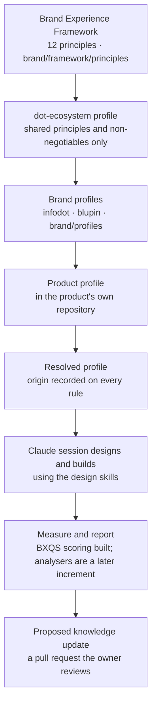

# Brand Experience

Purpose: how a brand's intended feelings become checkable product-experience decisions across the Dot ecosystem. This document is the doctrine: what the Brand Experience Framework and the brand profiles are, what counts as evidence for them, who may change them, how they apply to a single repository, and what ranks above them. The decisions behind it are in [ADR-0021](adr/ADR-0021-brand-feeling-engine.md); the data is in [brand/](brand/README.md); the code is in [services/brand-engine](services/brand-engine/README.md). It is `proposed`: it becomes `active` only when the owner says so.

> **Related documents:** [adr/ADR-0021-brand-feeling-engine.md](adr/ADR-0021-brand-feeling-engine.md) — the decision record · [adr/ADR-0022-bxqs-scoring-policy.md](adr/ADR-0022-bxqs-scoring-policy.md) — the scoring policy · [brand/rubrics/README.md](brand/rubrics/README.md) — the rubric, its immutability and semver policy · [brain.design.md](brain.design.md) — calm-technology standards for Brain's own surfaces (this document is the ecosystem-level counterpart for products) · [brain.dopemine.md](brain.dopemine.md) §2–3 — engagement ethics the habit and retention principles inherit · [brain.governance.md](brain.governance.md) — decision rights and the ethics gate · [brain.experiments.md](brain.experiments.md) — the only route to a validated finding · [brain.autonomy.md](brain.autonomy.md) — strategic direction is Level 3 · [brain.dkp.md](brain.dkp.md) — the field vocabulary reused (not the signed-pack machinery) · [schemas/brand-profile.schema.json](schemas/brand-profile.schema.json) · [schemas/brand-principle.schema.json](schemas/brand-principle.schema.json) · [schemas/brand-rubric.schema.json](schemas/brand-rubric.schema.json) · [schemas/brand-evidence.schema.json](schemas/brand-evidence.schema.json) · [schemas/brand-score.schema.json](schemas/brand-score.schema.json).

---

## 1. What this is, and what it is not

It is a way to say, for any Dot product: which feelings the owner intends a user to have, at which moments, through which concrete behaviours of the interface, with what evidence, and under which non-negotiable rules. Then to check a repository against that statement and report the gaps.

It is not a claim that users feel anything. A feeling in a profile is **intended**. It is labelled `intended` and `measured: false` in the data, and the validator rejects a profile that says otherwise. It is not a shared look: the ecosystem profile carries shared principles only, and every platform keeps its own functional identity. It is not a source of design output: generating a layout or copy is done by a Claude session using the design skills; the engine supplies the target and the scoring; the analysers that measure a repository are a later increment.

## 2. Layers

*Caption: knowledge flows down by `extends`, design happens in the session, and anything learned comes back only as a proposed change to reviewed data.*

| Layer | Where it lives | Who changes it |
|---|---|---|
| Framework (12 principles) | `brand/framework/principles/` in Dot.Brain | Proposed by AI or human; ratified by the owner only |
| Ecosystem and brand profiles | `brand/profiles/` in Dot.Brain | Same |
| Product profile | `brand/profile.json` (or any path) in the product repository | The product's owner; visibility follows that repository |
| Assessment reports | The product repository | Produced there; their visibility follows that repository |

## 3. The framework

Twelve principles, each with a definition, intended outcome, applicable contexts, engineering-shaped implementation guidance, validation method, limitations, evidence, status, version and the rubric dimensions it will feed. The twelve topics are fixed by the owner's brief: emotional positioning; identity and professional confidence; differentiation; trust, transparency, privacy and reliability; perceived value versus usefulness; visual and interaction craftsmanship; ease of use and cognitive load; onboarding and time to first result; habit through continuing value; retention and advocacy; accessibility; cross-platform consistency. A principle's `validation_method` separates four kinds of check, because a score must never blur them: **automated** tests, **expert review**, **observed behaviour**, and **customer feedback**.

## 4. Evidence classes

| Class | Requires | What it may support |
|---|---|---|
| `documented_research` | `citation`, `citation_verified` | A reason to expect an effect. Unverified until a human checks the source |
| `observed_behaviour` | `n`, `method` | What was seen in real use; bounded by `n` |
| `internal_hypothesis` | `rationale` | A direction to test. Never a finding |
| `validated_finding` | `experiment_ref` ([brain.experiments.md](brain.experiments.md)) | The only class that supports a causal claim |
| `declared_intent` | `declared_by` | What the owner (or a repository policy) has chosen. Not evidence that anything works |

A class may not carry another class's fields. A confidence value may not exceed what its evidence supports. Today every principle rests on hypothesis, declared intent or an unverified citation, and no experiment registry runs, so no validated finding exists. Psychological assumptions are therefore never stated as established facts, and the guidance in a principle is a proposal to test, not a result.

## 5. Status, and who may change what

`draft` → `proposed` → `ratified` → `superseded`. An AI session may write a draft and propose it. **Only a human approver ratifies**, from `proposed`, and a ratified document must name its approver and the time. Strategic direction is Level 3 ([brain.autonomy.md](brain.autonomy.md)), so the engine, the Skill and any agent may *recommend* a profile, a principle or a change to one and may never ratify it, even on a standing instruction. Superseded versions are kept with provenance, never overwritten ([CLAUDE.md](CLAUDE.md), rule 1).

The honest limit: a JSON file can only say who approved it. The validator rejects the false claims it can detect (ratified with no approver, an AI as approver, an approver on a draft). What makes a ratification real is the owner reviewing and merging a pull request that touches `/brand/`, which `.github/CODEOWNERS` routes to the owner. Branch protection that requires that review is a repository setting, not something this document can create.

## 6. Applying it to one repository

The engine works on any repository by itself. A product repository keeps its own `brand/profile.json` with `extends: "<brand or ecosystem profile>@<version>"`. Resolution merges conservatively: prohibitions (banned phrases, prohibited visuals, the claims policy) only accumulate; a non-negotiable inherited rule cannot be overridden; replacing any other inherited value needs a written reason in `overrides[]`, and an override that replaces nothing is an error. Each resolved rule carries `origin`, so a design decision can be traced back to the profile that set it. The profile cites the product's own `PRODUCT.md`, `DESIGN.md` and token file by path and sha256. `drift` reports a cited file that changed or disappeared, so a stale profile announces itself. Tokens are never copied into a profile.

## 7. Precedence

Domain safety, regulation, accessibility, security and functional correctness always outrank brand rules. A mining fleet dashboard, a trading screen, a mentoring platform and a document editor need different hierarchies, trust mechanisms and emotional registers; none may bend a safety alert, a legal duty, a contrast ratio, a permission check or a computed figure to fit a brand. The engine records where a brand rule yields (`domain_overrides[]`: principle, what it yields to, reason). It never records a brand rule winning. Reassurance does not soften an alert; a distinctive colour yields to contrast; a faster first result does not skip identity or consent; a polished figure that is wrong is worse than no figure.

## 8. Engagement and Dopemine

The habit (BXP-09) and retention (BXP-10) principles define value as the outcome a user chose. App opens, session time, scroll depth, streak length and notification click-through are never targets ([brain.dopemine.md](brain.dopemine.md) §2); they may be guard metrics. Both principles carry the constraint in their data, and every engagement-related recommendation is flagged for human review and goes through the Dopamine gate ([brain.governance.md](brain.governance.md) §5). The engine calls nothing in Dot.Dopemine; the relationship is reference-only. Dot.Memory use is limited to assessment history (what was measured against which profile version), opt-in and written only from Actions; it is decided in a later increment, and until then nothing here talks to Memory.

## 9. Scope and visibility

Version 1 covers Dot-owned and first-party products. Customer-brand profiles need tenant isolation, authentication and storage, so they need a running service and a separate ADR. Dot.Brain is public: a profile stored here must be classification `public` and contain nothing private or personal, and product profiles are refused here and belong in their own repositories.

## 10. The Brand Experience Quality Score (BXQS)

A 100-point score over twelve dimensions, built so that it cannot be inflated. Decided in [ADR-0022](adr/ADR-0022-bxqs-scoring-policy.md); the rubric is [brand/rubrics/bxqs-1.0.0.json](brand/rubrics/bxqs-1.0.0.json) (`proposed`, not ratified); the engine is `services/brand-engine/src/score/`. It is advisory: it never blocks a deploy, and there is no model in it.

**Three numbers, never one.** The *evidenced score* is the points actually earned. The *ceiling* is the most the evidence classes present and allowed could earn. The *attainment* is evidenced divided by ceiling. A report always shows all three, truncated and never rounded up.

**Four evidence classes.** Automated check, expert assessment, observed behaviour, customer feedback. Each dimension caps what automated and expert evidence together can earn (`cap_without_observed_or_customer`); the rest of the weight can be earned only from observed or customer results.

| # | Dimension | Weight | Cap without observed or customer |
|---|---|---:|---:|
| 1 | Emotional clarity and positioning | 8 | 0.50 |
| 2 | Brand distinctiveness | 7 | 0.60 |
| 3 | Usability and cognitive load | 12 | 0.60 |
| 4 | Visual and interaction craftsmanship | 9 | 0.80 |
| 5 | Functional completeness | 10 | 0.90 |
| 6 | Trust and transparency | 10 | 0.70 |
| 7 | Perceived and demonstrated value | 8 | 0.50 |
| 8 | Accessibility and inclusion | 12 | 0.70 |
| 9 | Cross-platform consistency (shared principles, not visual sameness) | 6 | 0.80 |
| 10 | Reliability and recovery from errors | 8 | 0.80 |
| 11 | Retention through continuing value (outcomes only) | 5 | 0 |
| 12 | Measurable customer outcomes | 5 | 0 |

**Rules the engine enforces.**

- An AI-only expert assessment counts at most 50% of the expert-eligible weight, and the assessor kind is always recorded. The builder of a change is never its sole assessor (its own assessment earns no points).
- A check or metric nobody measured counts as zero, is listed as *not measured*, and is never excluded from the denominator or given a default (the honesty rule of [brain.autonomy.md](brain.autonomy.md) section 3).
- Dimensions 11 and 12 are `not_measured` without real observed or customer evidence. Engagement counts (opens, streaks, session time, scroll depth, notification click-through) are rejected with a finding ([brain.dopemine.md](brain.dopemine.md) section 2).
- Confidence is High (two or more source classes including observed or customer evidence on at least half the weight), Medium (automated and expert evidence that agree, no observed or customer evidence) or Low (a single source, expert only, or disagreement of more than one level).
- Blockers: a WCAG A or AA failure, an unsupported claim, a failing test in scope, a violated domain override, an unresolved ethics-gate flag. A blocking finding also caps its own dimension, and a brand rule can never raise a score a safety, security or accessibility finding lowers.
- States: `build_verified` (attainment at least 90 percent, no blockers, every dimension at its floor), `release_ready` (evidenced score at least 90, no blockers, observed or customer evidence on dimensions 3, 6 and 7 and on 8 where assistive-technology testing is possible, confidence Medium or better, a ratified profile and a ratified rubric), otherwise `not_ready`. A draft or proposed profile or rubric caps the state at `build_verified`, and the report says why.

**Why 90 is out of reach on automated and expert evidence alone.** The ten dimensions that can be measured without people cap out at 4 + 4.2 + 7.2 + 7.2 + 9 + 7 + 4 + 8.4 + 4.8 + 6.4 = 62.2 points. A perfect run earns 62.2: full attainment, `build_verified`, not release. With only an AI as expert it earns about 49.8, which is 80.1 percent attainment and not even `build_verified`. The other 37.8 points are reserved for what no tool can fake: whether people could use it, trusted it, got value from it and got what they came for. To reach 90 honestly, at least 27.8 of them must be earned from real observed or customer results. A small observed or customer pilot (at least five participants per result) is what unlocks it; dimensions 11 and 12 need people who have come back, so they take time.

**Versioning.** A released rubric is immutable and its sha256 is recorded in every report. MAJOR: the dimension set, a weight or a cap. MINOR: checks or metrics added or changed. PATCH: wording. `compare` refuses across a major version unless both reports are for the same commit, annotates minor differences, shows per-dimension deltas and which evidence changed, and never re-bases a number. Ratifying a rubric is a separate record that names the hash it ratified; rubric changes are strategic direction and belong to the owner.

## 11. What exists and what does not

| Exists | Not yet built |
|---|---|
| Schemas for profiles, principles, the rubric, the evidence file and the score report | Analysers that read a repository and produce the evidence file |
| `services/brand-engine`: validator, registry, `extends` resolution, drift check, the BXQS scoring engine, `compare`, CLI | The Claude Skill that retrieves a profile and runs the workflow |
| The 12 principles (all `draft`) and profiles `dot-ecosystem`, `infodot`, `blupin` (all `draft`) | An Actions workflow |
| The rubric `bxqs-1.0.0` (`proposed`, released, hash pinned) and its golden tests | Any call to Dot.Memory or Dot.Dopemine |
| CODEOWNERS routing for `brand/`, the schemas and the scoring code | Customer-brand tenancy; demonstrations on example products |
| Tests, including every shipped file validating and the scoring rules on hand-computed fixtures | A ratified rubric or profile, and any real observed or customer evidence |

No real product has been scored. The only scores anywhere in this repository are test fixtures marked as such. Anything that claims otherwise is wrong.

---

## Change Log

| Version | Date | Author | Change |
|---|---|---|---|
| 0.1.0 | 2026-10-23 | Brand engine foundation (AI-drafted, owner to review) | Initial doctrine: layers, evidence classes, status rules, per-repo application, precedence, engagement constraint, scope, and an explicit list of what does not exist yet. |
| 0.2.0 | 2026-10-23 | Brand engine scoring (AI-drafted, owner to review) | Added section 10, the Brand Experience Quality Score: evidenced score, ceiling and attainment; caps; AI-only 50% and builder independence; blockers, states and confidence; why 90 needs observed or customer evidence; semver policy (MAJOR: dimension set, weights or caps; MINOR: checks added or changed; PATCH: wording). Status remains `proposed`. |

## Open Questions

| Question | Owner → Approver |
|---|---|
| Does the owner want branch protection requiring a CODEOWNERS review on `/brand/`? Without it, ratification by merge is a convention, not a control | Chief Intelligence Architect → owner |
| Review the proposed numbers in `bxqs-1.0.0` (share split of each cap, floors, minimum observed sample of five, blocking-finding cap of 0.5, check and metric weights) and ratify the rubric, or ask for a new version | UX Agent → owner |
| Which of InfoDot's conflicting design documents governs (`docs/infodot-ui-design-guide.md` versus `PRODUCT.md` and `DESIGN.md`)? The `infodot` profile records the conflict and decides neither | UX Agent → owner |
| Should Blupin share the ecosystem principles? No product or audience has been identified, so its profile extends nothing | Chief Intelligence Architect → owner |
| Verify the three recorded citations (WCAG 2.2, Nielsen's usability heuristics, Sweller 1988) or remove them | Knowledge Agent → Chief Knowledge Engineer |
